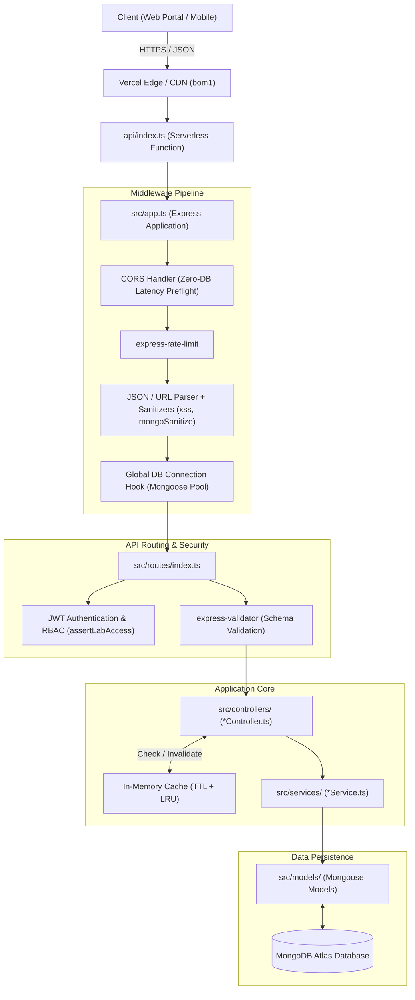
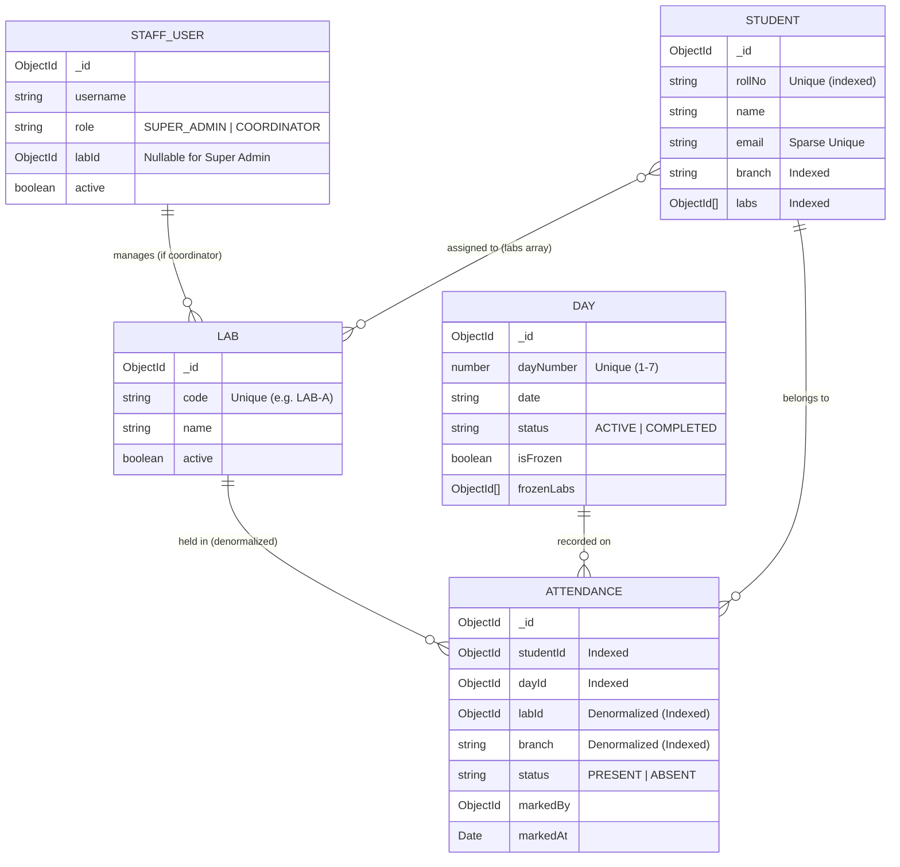

# CodeCrusade Portal API

> **Centralized Multi-Lab Workshop Attendance, Analytics & Management Engine**

[](https://www.typescriptlang.org/)
[](https://nodejs.org/)
[](https://expressjs.com/)
[](https://www.mongodb.com/)
[](https://vercel.com/)
[](https://jestjs.io/)
[](#license)

---

## 1. Overview & Branding

**CodeCrusade Portal API** is the enterprise backend powering the **CodeCrusade Centralized Workshop Attendance Platform**. Engineered specifically for intensive multi-day, multi-lab engineering bootcamps, it orchestrates real-time attendance marking, granular role-based coordinator access, fraud-resistant session freezes, and deep analytical performance reports across hundreds of students and multiple physical/virtual labs.

### Key Capabilities
- **Multi-Lab Attendance Coordination**: Manage physical labs and online batches simultaneously with granular assignment of lab coordinators and centralized super-admin oversight.
- **Fraud-Resistant Freeze Architecture**: Lock attendance on a global workshop-day level or individual lab level (`frozenLabs`), preventing retroactive edits once marking windows conclude.
- **Transactional Bulk Marking**: Atomically upsert hundreds of attendance records using MongoDB sessions and bulk writes with automatic present/absent state transitions.
- **Optimized In-Memory Cache**: High-throughput sub-millisecond cached responses for dashboard overviews and heavy analytical queries, paired with automated regex pattern cache invalidation on data mutations.
- **Deep Analytics Engine**: Real-time cohort retention curves, departmental branch contributions, lab capacity utilization, and early-warning defaulter detection.

---

## 2. Tech Stack

| Layer | Technology | Details |
|---|---|---|
| **Runtime & Language** | **Node.js 18+** / **TypeScript 5.4** | ES2022 target, strict type safety, ts-node execution, clean zero-warning compilation. |
| **Web Framework** | **Express 5.2.1** | Modern Express 5 routing, extended query parsing, custom async error propagation. |
| **Database & ODM** | **MongoDB Atlas** / **Mongoose 9.1** | Connection pooling, zlib network compression, compound indexes, lean queries. |
| **Authentication & RBAC** | **JWT (`jsonwebtoken` 9)** / **bcrypt** | Secure Bearer token authentication, 7-day rolling sessions, password hashing. |
| **Security & Hygiene** | **Helmet**, **express-mongo-sanitize**, **xss-clean** | NoSQL query injection prevention, XSS filter sanitization, CSP/security headers. |
| **Traffic Control** | **express-rate-limit 8.7** | IP-based request throttling (100 req/15 min) behind trusted reverse proxy layers. |
| **Caching Engine** | **In-Memory TTL + LRU Engine** | Custom high-speed cache with regex invalidation patterns (`src/utils/cache.ts`). |
| **Testing Suite** | **Jest 30** / **Supertest 7** / **ts-jest** | Isolated end-to-end integration and API tests with automatic test database cleanup. |
| **Deployment** | **Vercel Serverless** | Serverless function deployment (`api/index.ts`, BOM1 Mumbai region). |

---

## 3. Architecture & Design

### System Architecture Flow



### Architectural Principles

1. **Denormalization for Extreme Read Performance**:
   - In standard relational designs, querying attendance by student branch or lab requires costly multi-collection `$lookup` joins.
   - CodeCrusade denormalizes `labId` and `branch` directly onto the `Attendance` collection. This transforms heavy multi-table aggregations in `analyticsService` and `dashboardService` into fast, compound-indexed point scans.
2. **Event-Driven Cache Invalidation**:
   - Read-heavy endpoints (`/api/dashboard/*`, `/api/analytics/*`) cache results in memory.
   - When mutations happen in `studentController`, `dayController`, or `attendanceController`, the cache selectively evicts affected namespaces using regex matching (`cache.delPattern(/analytics|dashboard/)`).
3. **Serverless Lifecycle & Cold-Start Optimization**:
   - In serverless hosting (Vercel), preflight `OPTIONS` requests must resolve instantaneously.
   - CORS middleware runs **before** the asynchronous database connection hook, ensuring browser preflight checks never experience cold-start connection latency.
4. **Structured Error Hierarchy**:
   - Standardized error contracts using `ApplicationError`, `NotFoundError`, `UnauthorizedError`, `ForbiddenError`, and `ValidationError` ensure predictable JSON error responses across all controllers.

---

## 4. Project Structure

```
CodeCrusade-portal-api/
├── api/
│   └── index.ts                 # Vercel serverless entry point
├── scripts/                     # Local developer & seeding scratch scripts (gitignored)
│   ├── parse_excel.py           # Workshop student onboarding script
│   └── reset_and_seed_real.ts   # Workshop database initializer
├── src/
│   ├── app.ts                   # Express application setup & middleware assembly
│   ├── config/                  # Configuration & environment variables
│   │   ├── db.ts                # MongoDB connection lifecycle manager
│   │   └── env.ts               # Environment variable schemas & defaults
│   ├── controllers/             # Route controllers (request handling & cache eviction)
│   │   ├── analyticsController.ts
│   │   ├── attendanceController.ts
│   │   ├── authController.ts
│   │   ├── dashboard.controller.ts
│   │   ├── dayController.ts
│   │   ├── healthController.ts
│   │   ├── labController.ts
│   │   └── studentController.ts
│   ├── middleware/              # Unified middleware stack
│   │   ├── authMiddleware.ts    # JWT verification & RBAC context injection
│   │   ├── errorMiddleware.ts   # Centralized error handler & 404 handler
│   │   └── validateRequest.ts   # express-validator request interceptor
│   ├── models/                  # Mongoose data schemas & indexes
│   │   ├── Attendance.ts        # Denormalized attendance records
│   │   ├── Day.ts               # Workshop session days & lab freeze states
│   │   ├── Lab.ts               # Physical / virtual workshop labs
│   │   ├── StaffUser.ts         # Coordinators and super administrators
│   │   └── Student.ts           # Student registry & multi-lab assignments
│   ├── routes/                  # Express route definitions
│   │   ├── analyticsRoutes.ts
│   │   ├── attendanceRoutes.ts
│   │   ├── authRoutes.ts
│   │   ├── dashboard.routes.ts
│   │   ├── dayRoutes.ts
│   │   ├── healthRoutes.ts
│   │   ├── index.ts             # Route aggregator & namespace mounter
│   │   ├── labRoutes.ts
│   │   └── studentRoutes.ts
│   ├── scripts/                 # Production-safe migration & seeding utilities
│   │   ├── migrate-attendance.ts# Attendance backfill migration
│   │   ├── migrate-labs.ts      # Multi-lab schema migration script
│   │   └── seed.ts              # Deterministic development seeder
│   ├── services/                # Business logic, metrics calculation & DB queries
│   │   ├── analyticsService.ts
│   │   ├── attendanceService.ts
│   │   ├── authService.ts
│   │   ├── dashboard.service.ts
│   │   ├── dayService.ts
│   │   ├── labService.ts
│   │   └── studentService.ts
│   ├── types/                   # TypeScript definitions
│   │   ├── express.d.ts         # Express Request augmentation (req.user)
│   │   └── index.ts             # Pagination & standard API response types
│   └── utils/                   # Shared utilities
│       ├── apiFeatures.ts       # Query filtering, sorting & pagination
│       ├── assertLabAccess.ts   # RBAC lab access boundary verification
│       ├── asyncHandler.ts      # Async route wrapper
│       ├── cache.ts             # In-memory TTL / LRU cache with regex eviction
│       ├── errors.ts            # Strongly-typed ApplicationError classes
│       └── logger.ts            # Winston logging implementation
├── tests/                       # Jest integration test suites
│   ├── auth.test.ts             # Authentication, token generation & RBAC tests
│   ├── phase3.test.ts           # Student registry & lab assignment tests
│   ├── phase4.test.ts           # Attendance marking & freeze lockout tests
│   ├── phase5.test.ts           # Dashboard analytics & query tests
│   ├── phase6.test.ts           # Health check & security validation tests
│   └── setup.ts                 # Test database bootstrap & teardown
├── jest.config.js               # Jest configuration
├── package.json                 # Dependencies & scripts
├── tsconfig.json                # TypeScript compiler configuration
└── vercel.json                  # Serverless deployment configuration
```

---

## 5. Data Models & Database Design

### Schemas & Compound Indexes



### High-Performance Indexes
- **Attendance**:
  - `{ studentId: 1, dayId: 1 }` (Unique compound index — prevents duplicate attendance)
  - `{ dayId: 1, status: 1 }` (Fast counting of present/absent per day)
  - `{ studentId: 1, status: 1 }` (Student distribution queries)
  - `{ labId: 1, branch: 1 }` (Direct indexed slicing without `$lookup`)
  - `{ createdAt: -1 }`, `{ updatedAt: -1 }` (Covered recent-activity feeds)
- **Student**:
  - `{ rollNo: 1 }` (Unique)
  - `{ labs: 1, branch: 1 }` (Compound filtering for batch rosters)

---

## 6. API Reference & Contracts

All requests expect `Content-Type: application/json`. Authenticated routes require `Authorization: Bearer <JWT_TOKEN>`.

### Endpoint Summary

| Group | Method | Path | Access | Description |
|---|---|---|---|---|
| **Health** | `GET` | `/api/health` | Public | System status, uptime & DB connection check. |
| **Auth** | `POST` | `/api/auth/login` | Public | Authenticate staff member, returns JWT token. |
| | `GET` | `/api/auth/me` | Authenticated | Fetch authenticated user profile & lab context. |
| **Labs** | `GET` | `/api/labs` | Authenticated | List all workshop labs. |
| | `POST` | `/api/labs` | Super Admin | Create a new physical or virtual lab. |
| | `PUT` | `/api/labs/:id` | Super Admin | Update lab metadata or active state. |
| **Days** | `GET` | `/api/days` | Authenticated | List workshop days with status and freeze flags. |
| | `POST` | `/api/days` | Super Admin | Register a workshop day session. |
| | `POST` | `/api/days/:id/freeze` | Super Admin | Lock all attendance records for a given day. |
| | `POST` | `/api/days/:id/unfreeze` | Super Admin | Unlock day attendance for emergency corrections. |
| | `POST` | `/api/days/:dayId/labs/:labId/freeze` | Coordinator / Admin | Lock attendance for a specific lab. |
| | `POST` | `/api/days/:dayId/labs/:labId/unfreeze` | Coordinator / Admin | Unlock attendance for a specific lab. |
| **Students**| `GET` | `/api/students` | Authenticated | List/paginate students with lab & branch filters. |
| | `POST` | `/api/students` | Super Admin | Register a student with roll number and lab assignments. |
| | `PUT` | `/api/students/:id` | Super Admin | Update student information. |
| **Attendance**| `POST` | `/api/attendance/mark` | Coordinator / Admin | Upsert attendance for a single student on a day. |
| | `POST` | `/api/attendance/bulk` | Coordinator / Admin | Batch upsert attendance for a roster (with transactions). |
| | `POST` | `/api/attendance/missing-absent` | Coordinator / Admin | Auto-mark all unmarked lab students as ABSENT. |
| | `GET` | `/api/attendance/student/:studentId` | Authenticated | View 7-day attendance timeline for a student. |
| **Dashboard**| `GET` | `/api/dashboard/overview` | Authenticated | Real-time aggregate KPI metrics & recent logs. |
| | `GET` | `/api/dashboard/days` | Authenticated | Daily breakdown of attendance percentages. |
| | `GET` | `/api/dashboard/labs` | Authenticated | Lab-by-lab performance and turnout comparisons. |
| | `GET` | `/api/dashboard/matrix` | Authenticated | Matrix grid of student attendance across days. |
| **Analytics**| `GET` | `/api/analytics/retention` | Authenticated | Cohort retention curve across workshop timeline. |
| | `GET` | `/api/analytics/branch-contribution`| Authenticated | Branch representation breakdown. |
| | `GET` | `/api/analytics/lab-utilization` | Authenticated | Seat occupancy vs capacity analysis. |
| | `GET` | `/api/analytics/at-risk` | Authenticated | Identify students at risk of attendance default. |

---

## 7. Environment Variables

Create a `.env` file in the project root based on `.env.example`:

```bash
# Server Configuration
PORT=5000
NODE_ENV=development

# Database Connection
MONGODB_URI=mongodb+srv://<username>:<password>@cluster.mongodb.net/codecrusade?retryWrites=true&w=majority

# CORS Configuration (comma-separated for multiple origins)
CORS_ORIGIN=http://localhost:5173,https://code-crusade.vercel.app

# JWT Authentication
JWT_SECRET=your_super_secret_jwt_key_here_min_32_characters
JWT_EXPIRES_IN=7d
```

---

## 8. Setup & Development Guide

### Prerequisites
- **Node.js** (v18.0.0 or higher)
- **npm** (v9.0.0 or higher)
- **MongoDB** instance (local running on port `27017` or MongoDB Atlas URI)

### 1. Installation
Clone the repository and install dependencies:
```bash
git clone https://github.com/jimfleax/CodeCrusade-portal-api.git
cd CodeCrusade-portal-api
npm install
```

### 2. Environment Configuration
Copy `.env.example` to `.env` and fill in your connection details:
```bash
cp .env.example .env
```

### 3. Database Seeding
Populate the database with deterministic sample data (1 Super Admin, 2 Coordinators, 6 Labs, 180 Students across 6 branches, and 3 days of historical attendance):
```bash
npm run seed
```

Default credentials seeded:
- **Super Admin**: `admin` / `admin123`
- **Lab Coordinator**: `coord_a` / `coord123`

### 4. Running the Development Server
Run the local Vercel development server with hot reload:
```bash
npm run dev
```
The API will be available at `http://localhost:5000/api`.

### 5. Production Compilation
Compile TypeScript to production JavaScript in `./dist`:
```bash
npm run build
```

---

## 9. Testing & Quality Assurance

The codebase enforces strict test-driven safety guarantees. Tests run against an isolated database (automatically appending `_test` to prevent production/dev data mutation).

### Running Test Suites
```bash
# Run all Jest test suites sequentially
npm test

# Run tests in watch mode
npm run test:watch
```

### Test Coverage Highlights
- **Auth & Access Control (`tests/auth.test.ts`)**: Password hashing, JWT token issuance, RBAC route protection, expired token handling.
- **Student & Lab Management (`tests/phase3.test.ts`)**: Student creation, branch filtering, multi-lab assignments, duplicate roll number rejection.
- **Attendance & Freeze Rules (`tests/phase4.test.ts`)**: Single/bulk attendance upserts, day freeze lockout verification, lab-specific freeze enforcement.
- **Dashboard & Aggregations (`tests/phase5.test.ts`)**: Overview KPIs, day turnout percentages, lab utilization aggregations.
- **Security & Health (`tests/phase6.test.ts`)**: Health probe validation, XSS and NoSQL input sanitization, rate-limiting response verification.

---

## 10. License

This project is licensed under the **ISC License**.
