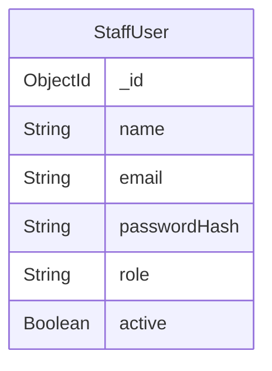

# Phase 2 Context: Phase 2 - Authentication & Authorization: StaffUser model, authService, authController, authMiddleware

## Global Project Guidelines
- The API should follow resource-oriented design.
- The controllers should remain thin.
- Business logic such as attendance validation, bulk upsert behavior, statistics calculation, and permission checks should reside primarily in services.
- Passwords must never be stored in plaintext.
- Email must be unique.
- Inactive staff cannot authenticate.

## Phase-Specific Requirements
# 8. Staff User Model

Represents authenticated administrative users.

### Fields

StaffUser
-------------------------
_id
name
email
passwordHash
role
active
createdAt
updatedAt

### Role
SUPER_ADMIN
COORDINATOR

### Constraints
- Email must be unique.
- Inactive staff cannot authenticate.
- Passwords must never be stored in plaintext.

## Authentication API
POST   /api/auth/login
POST   /api/auth/logout
GET    /api/auth/me

## Authentication and Authorization
The system should authenticate administrative users before allowing attendance operations.
Recommended V1 model:
Authentication
→ JWT or secure session
Authorization
→ Role-based access control

## Resolved Clarifications (Relevant to This Phase)
None specific to authentication other than JWT/session requirement.

## Schema Context
# Database Schema Map

## Entity Relationship Overview

## Models Scaffolded
| Model | File | Fields | References | Status Enum |
|-------|------|--------|------------|-------------|
| StaffUser | src/models/StaffUser.ts | name, email, passwordHash, role, active | — | SUPER_ADMIN, COORDINATOR |

## Shared Utilities Available
No shared utilities registered yet.

## API Contracts from Previous Phases
No existing API contracts from previous phases.
