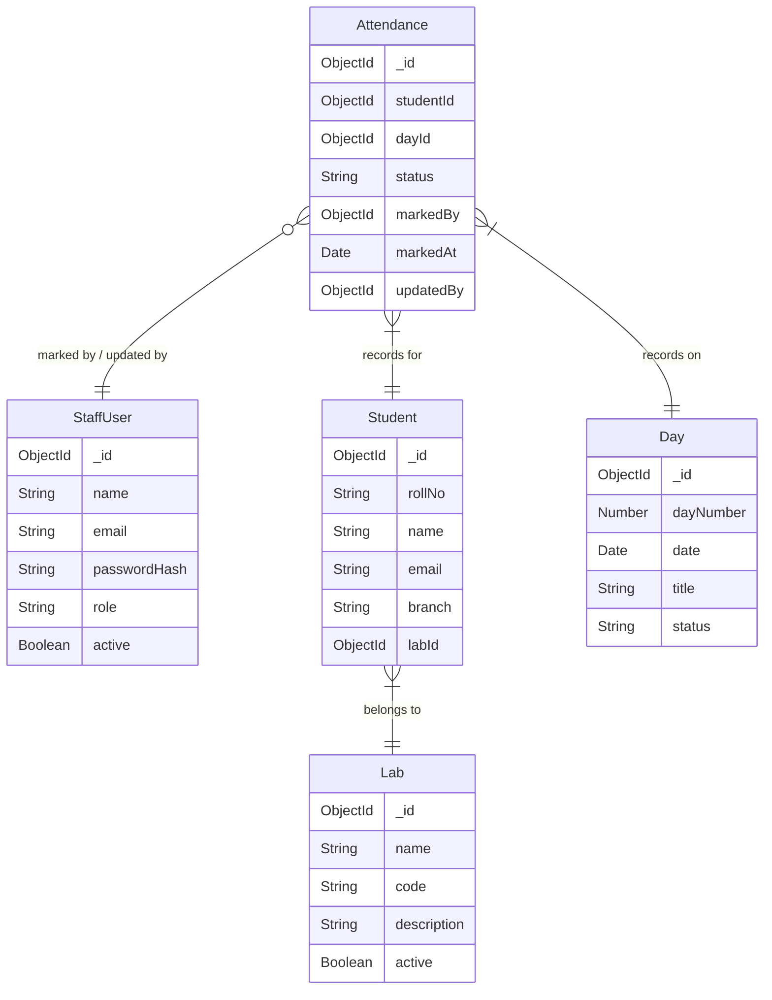

# Phase 3 Context: Core Entities: Lab, Student, Day models, CRUD services, controllers, and routes

## Global Project Guidelines
Primary Backend Stack: MongoDB, Express.js, TypeScript
Runtime: Node.js

The controllers should remain thin.
Business logic such as attendance validation, bulk upsert behavior, statistics calculation, and permission checks should reside primarily in services.

Error Handling:
The API should return consistent errors.
Example:
{
  "success": false,
  "error": {
    "code": "...",
    "message": "..."
  }
}

Security:
- validate all IDs
- sanitize/validate user-provided strings

## Phase-Specific Requirements

# 9. Student Model
Represents workshop participants.

### Fields
_id
rollNo
name
email
branch
labId
createdAt
updatedAt

### Constraints
- `rollNo` should be unique.
- `labId` is required.
- Student identity data should not be duplicated inside attendance records.

# 10. Lab Model
Represents the fixed workshop labs.

### Fields
_id
name
code
description
active
createdAt
updatedAt

`code` should be unique if used.

# 11. Day Model
Represents a workshop day.

### Fields
_id
dayNumber
date
title
status
createdAt
updatedAt

### Status
A simple lifecycle can be:
UPCOMING
ACTIVE
COMPLETED

### Constraints
`dayNumber` must be unique within the workshop.
The application must never assume that the final day is Day 7.

# 28. Proposed API Structure

## Students
GET    /api/students
GET    /api/students/:id
POST   /api/students
PATCH  /api/students/:id
DELETE /api/students/:id

## Labs
GET    /api/labs
GET    /api/labs/:id
POST   /api/labs
PATCH  /api/labs/:id

## Days
GET    /api/days
GET    /api/days/:id
POST   /api/days
PATCH  /api/days/:id

# 29. Query and Indexing Strategy

### Students
unique: rollNo
index: labId
index: email

### Days
unique: dayNumber
index: date

# 30. Backend Service Responsibilities
Controllers should primarily handle:
- request validation,
- authentication context,
- calling services,
- response formatting,
- HTTP status codes.

Services should handle:
- business rules,
- database operations,
- authorization logic.

## Resolved Clarifications (Relevant to This Phase)
None specified.

## Schema Context
# Database Schema Map

## Entity Relationship Overview

## Models Scaffolded
| Model | File | Fields | References | Status Enum |
|-------|------|--------|------------|-------------|
| StaffUser | src/models/StaffUser.ts | name, email, passwordHash, role, active | — | SUPER_ADMIN, COORDINATOR |
| Student | src/models/Student.ts | rollNo, name, email, branch, labId | Lab (labId) | — |
| Lab | src/models/Lab.ts | name, code, description, active | — | — |
| Day | src/models/Day.ts | dayNumber, date, title, status | — | UPCOMING, ACTIVE, COMPLETED |
| Attendance | src/models/Attendance.ts | studentId, dayId, status, markedBy, markedAt, updatedBy | Student (studentId), Day (dayId), StaffUser (markedBy, updatedBy) | PRESENT, ABSENT |

## Cascade Rules
- Deleting a Student → cascade delete their Attendance records
- Deleting a Lab → cascade delete Students in that Lab (or prevent deletion)
- Deleting a Day → cascade delete Attendance for that Day

## Shared Utilities Available
No shared utilities registered yet.

## API Contracts from Previous Phases
Phase 1: No API endpoints.
Phase 2:
## POST /api/auth/login
- Auth required: No
- Request body: { email: string (required), password: string (required) }
- Success: 200 { success: true, data: { user: { _id: string, name: string, email: string, role: string }, token: string } }
- Errors: 400 (validation), 401 (invalid credentials / inactive user), 500 (server error, shape: { success: false, error: { code: string, message: string } })

## POST /api/auth/logout
- Auth required: Yes (JWT)
- Request body: None
- Success: 200 { success: true, message: "Logged out successfully" }
- Errors: 500 (server error)

## GET /api/auth/me
- Auth required: Yes (JWT)
- Request body: None
- Success: 200 { success: true, data: { user: { _id: string, name: string, email: string, role: string } } }
- Errors: 401 (unauthorized), 500 (server error)
