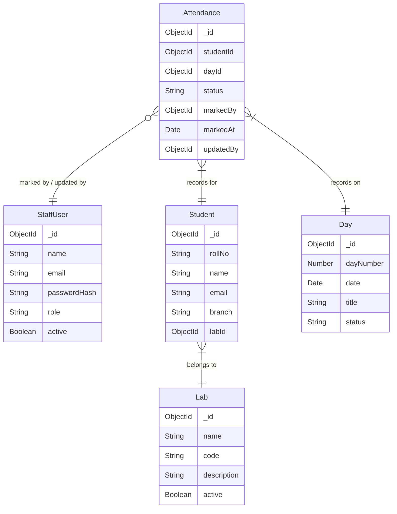

# Phase 4 Context: Phase 4 - Attendance System: Attendance model, bulk upsert business logic, validation, endpoints

## Global Project Guidelines
The application has two primary user-facing areas:
1. Coordinator Interface — used by one or more coordinators to mark and modify student attendance.
2. Super Admin Interface — used by the workshop authority to monitor students, attendance, labs, daily attendance, and overall workshop statistics.
Student data will initially be populated manually in the database. Each student has a fixed lab assignment.
Attendance is recorded exactly once per student per workshop day and has only two possible states:
PRESENT
ABSENT
All students are expected to attend every workshop day.
The system must prioritize correctness of attendance data, simplicity of marking attendance, strong database integrity, and useful administrative insights.
Controllers should primarily handle: request validation, authentication context, calling services, response formatting, HTTP status codes.
Services should handle: business rules, attendance calculations, bulk validation, database operations, authorization logic, dashboard aggregations.

## Phase-Specific Requirements
# 4. Core Business Rules
## 4.2 One attendance event per day
There is exactly one attendance marking opportunity for each student on each day.
There are no separate sessions within a day.
Student + Day = one attendance record

## 4.4 Attendance statuses
Only two statuses are supported: PRESENT, ABSENT.

## 4.6 Attendance uniqueness
There must never be more than one attendance record for the same student on the same day.
Database-level uniqueness must enforce: UNIQUE(studentId, dayId)

## 4.7 Coordinator modification
Coordinators may modify previously submitted attendance.
The system must retain: who originally marked the attendance, when it was marked, who last modified it, when it was last modified.

# 12. Attendance Model
Attendance is the central transactional entity.
Fields: _id, studentId, dayId, status, markedBy, markedAt, updatedBy, updatedAt
Status: PRESENT, ABSENT
Relationships: studentId → Student, dayId → Day, markedBy → StaffUser, updatedBy → StaffUser
Critical database constraint: A compound unique index must exist on: (studentId, dayId)

# 14. Attendance Integrity Rules
Rule 1 — Every student must have an explicit status
A daily bulk submission is only valid when every expected student is included.
Rule 2 — No unknown students
Rule 3 — No unknown days
Rule 4 — No duplicate student entries
Rule 5 — No duplicate database attendance
Rule 6 — Only valid statuses
Rule 7 — Attendance updates cannot accidentally create duplicates

# 16. Bulk Attendance API Contract
PUT /api/days/:dayId/attendance
Request:
{
  "attendance": [
    { "studentId": "student-id-1", "status": "PRESENT" },
    { "studentId": "student-id-2", "status": "ABSENT" }
  ]
}
The backend determines dayId + studentId and performs an update or insert accordingly.
The request should be treated atomically wherever practical.
If validation fails, the entire operation should fail rather than partially updating attendance.

# 28. Proposed API Structure
## Attendance
GET    /api/attendance
GET    /api/attendance/:id
GET    /api/students/:studentId/attendance
GET    /api/days/:dayId/attendance
PUT    /api/days/:dayId/attendance
PATCH  /api/attendance/:id
Example filters:
GET /api/attendance?dayId=...
GET /api/attendance?dayId=...&labId=...
GET /api/attendance?dayId=...&status=ABSENT

# 36. Important Edge Cases
Duplicate attendance submission: The operation must update existing records rather than create duplicates.
Partial payload: The API should reject the submission.
Duplicate student in payload: The API should reject the request.

## Resolved Clarifications (Relevant to This Phase)
None specified.

## Schema Context
# Database Schema Map

## Entity Relationship Overview

## Models Scaffolded
| Model | File | Fields | References | Status Enum |
|-------|------|--------|------------|-------------|
| StaffUser | src/models/StaffUser.ts | name, email, passwordHash, role, active | — | SUPER_ADMIN, COORDINATOR |
| Student | src/models/Student.ts | rollNo, name, email, branch, labId | Lab (labId) | — |
| Lab | src/models/Lab.ts | name, code, description, active | — | — |
| Day | src/models/Day.ts | dayNumber, date, title, status | — | UPCOMING, ACTIVE, COMPLETED |
| Attendance | src/models/Attendance.ts | studentId, dayId, status, markedBy, markedAt, updatedBy | Student (studentId), Day (dayId), StaffUser (markedBy, updatedBy) | PRESENT, ABSENT |

## Cascade Rules
- Deleting a Student → cascade delete their Attendance records
- Deleting a Lab → cascade delete Students in that Lab (or prevent deletion)
- Deleting a Day → cascade delete Attendance for that Day

## Shared Utilities Available
No shared utilities registered yet.

## API Contracts from Previous Phases
Phase 2 created Auth routes: POST /api/auth/login, POST /api/auth/logout, GET /api/auth/me
Phase 3 created CRUD for Students, Labs, Days.
