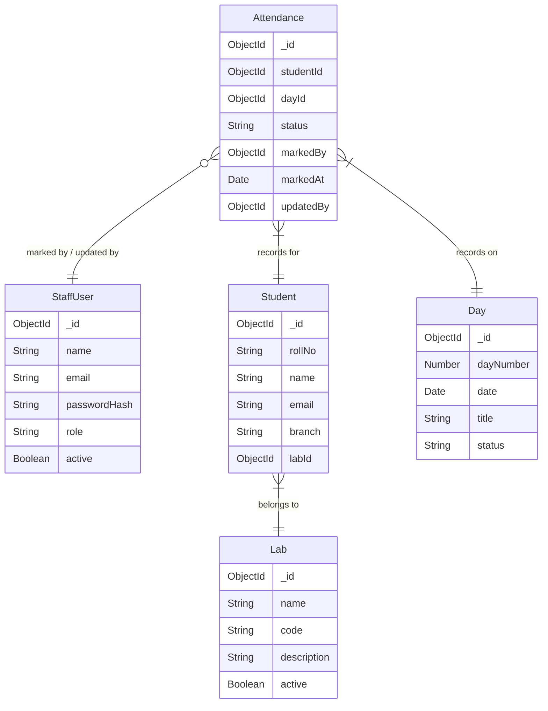

# Phase 5 Context: Phase 5 - Dashboard & Analytics: Aggregation pipelines, overview, day/lab/student stats, distribution, completion

## Global Project Guidelines
The Centralized Python Workshop Attendance Tracker is a web-based administrative system for recording, managing, monitoring, and analyzing student attendance during a multi-day Python workshop.
Primary Backend Stack: MongoDB, Express.js, TypeScript
Runtime: Node.js
Controllers should remain thin.
Business logic such as attendance validation, bulk upsert behavior, statistics calculation, and permission checks should reside primarily in services.
Use schema validation at the API boundary.
Every API request should validate IDs, enums, required fields, arrays, duplicates, pagination parameters, filters.

## Phase-Specific Requirements

# 18. Super Admin Dashboard
The Super Admin dashboard should provide information at multiple levels.
## 18.1 Overall Workshop Overview
Primary metrics:
Total Students
Total Labs
Days Created
Days Completed
Expected Attendance
Recorded Attendance
Present
Absent
Overall Attendance %

# 19. Attendance Rate Definition
The system should use a single centralized definition.
Attendance Rate = Present Records ÷ Expected Attendance Records × 100
The formula should live in a service/helper layer and be reused by: Dashboard, Student analytics, Lab analytics, Day analytics, Exports.

# 20. Day-Level Analytics
The Super Admin should be able to inspect attendance for each day.
Example: Present, Absent, Rate.
Across the workshop: day-by-day attendance trend, present vs absent distribution, number of students marked.
The dashboard must clearly distinguish "No attendance submitted" from "Attendance submitted with 100% absence/presence distribution".

# 21. Lab-Level Analytics
The Super Admin should be able to inspect each lab.
Lab analytics should support: All Days, Specific Day.

# 22. Student-Level Analytics
The Super Admin must be able to search for a student. Search fields: Name, Roll Number, Email.
Student profile should contain: Name, Roll No, Email, Branch, Lab, Overall Attendance, Present Count, Absent Count, Days Recorded.
Attendance timeline: Day-by-Day Present/Absent status.

# 23. Attendance Matrix / Heatmap
The Super Admin should have an optional matrix view: Student vs Day.
The matrix should support: search, lab filtering, branch filtering, day filtering.

# 24. Attendance Distribution
The dashboard may show how attendance is distributed across students (e.g. 100% attendance, 90-99%, etc.).

# 25. Data Completion Monitoring
The Super Admin should be able to determine whether attendance has been fully recorded.
Because every student is expected to attend every day, a completed day must contain exactly: number of students attendance records.

# 26. Daily Summary
For each day: Total Students, Present, Absent, Attendance Rate, Lab Breakdown.

## Dashboard Endpoints
GET /api/dashboard/overview
GET /api/dashboard/days
GET /api/dashboard/labs
GET /api/dashboard/students/:studentId
Analytics should preferably be calculated server-side rather than sending all raw attendance records to the frontend for every dashboard calculation.

## Schema Context
# Database Schema Map

## Entity Relationship Overview

## Models Scaffolded
| Model | File | Fields | References | Status Enum |
|-------|------|--------|------------|-------------|
| StaffUser | src/models/StaffUser.ts | name, email, passwordHash, role, active | — | SUPER_ADMIN, COORDINATOR |
| Student | src/models/Student.ts | rollNo, name, email, branch, labId | Lab (labId) | — |
| Lab | src/models/Lab.ts | name, code, description, active | — | — |
| Day | src/models/Day.ts | dayNumber, date, title, status | — | UPCOMING, ACTIVE, COMPLETED |
| Attendance | src/models/Attendance.ts | studentId, dayId, status, markedBy, markedAt, updatedBy | Student (studentId), Day (dayId), StaffUser (markedBy, updatedBy) | PRESENT, ABSENT |

## Cascade Rules
- Deleting a Student → cascade delete their Attendance records
- Deleting a Lab → cascade delete Students in that Lab (or prevent deletion)
- Deleting a Day → cascade delete Attendance for that Day

## Shared Utilities Available
No shared utilities registered yet.

## API Contracts from Previous Phases
(Assuming none are strictly needed to state right now, but we can state we have standard API response formatting and previous phases implemented auth, lab, day, student, attendance endpoints)
