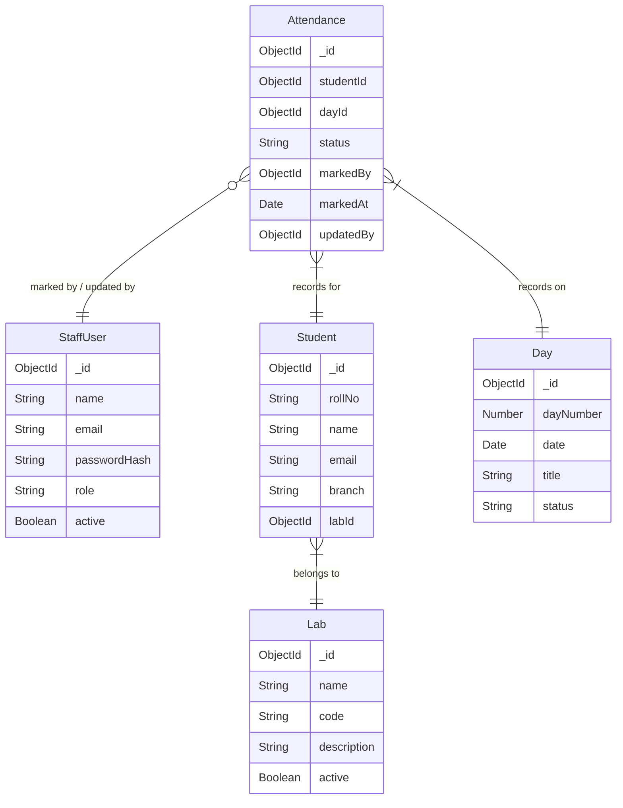

# Phase 6 Context: Phase 6 - Hardening & Polish: Integrate routes in app.ts, seed script, security hardening, final tests

## Global Project Guidelines
The backend must:
- hash passwords securely,
- never return password hashes through APIs,
- validate authorization on the server,
- validate all IDs,
- reject unauthorized attendance operations,
- use HTTPS in production,
- protect authentication endpoints against abuse,
- avoid trusting client-provided role information,
- sanitize/validate user-provided strings,
- configure CORS explicitly,
- use secure environment variables for secrets.

The API should return consistent errors.
Example:
{
  "success": false,
  "error": {
    "code": "...",
    "message": "..."
  }
}

## Phase-Specific Requirements
### Seed Script
- A seed script is required to initialize the database with basic data (e.g. Super Admin user) for development and initial deployment.
### App Integration
- Integrate all completed routes (auth, students, labs, days, attendance, dashboard) into the main Express application (`app.ts`).
### Security Hardening
- Implement security best practices (e.g., helmet, cors, rate limiting, mongo sanitize, xss clean).
### Testing
- Ensure the application passes unit and integration tests.
- Attendance percentage calculation, daily completion calculation, payload validation, permission checks, duplicate detection.
- Staff authentication, Student retrieval, Day retrieval, Attendance submission, Attendance modification, Dashboard aggregation.
- Critical attendance tests: Student + Day cannot be duplicated; 179/180 attendance records cannot be submitted as complete; Invalid status cannot be stored; Existing attendance is updated rather than duplicated; Coordinator cannot access unauthorized administrative operations.

## Resolved Clarifications (Relevant to This Phase)
N/A

## Schema Context
# Database Schema Map

## Entity Relationship Overview

## Models Scaffolded
| Model | File | Fields | References | Status Enum |
|-------|------|--------|------------|-------------|
| StaffUser | src/models/StaffUser.ts | name, email, passwordHash, role, active | — | SUPER_ADMIN, COORDINATOR |
| Student | src/models/Student.ts | rollNo, name, email, branch, labId | Lab (labId) | — |
| Lab | src/models/Lab.ts | name, code, description, active | — | — |
| Day | src/models/Day.ts | dayNumber, date, title, status | — | UPCOMING, ACTIVE, COMPLETED |
| Attendance | src/models/Attendance.ts | studentId, dayId, status, markedBy, markedAt, updatedBy | Student (studentId), Day (dayId), StaffUser (markedBy, updatedBy) | PRESENT, ABSENT |

## Cascade Rules
- Deleting a Student → cascade delete their Attendance records
- Deleting a Lab → cascade delete Students in that Lab (or prevent deletion)
- Deleting a Day → cascade delete Attendance for that Day

## Shared Utilities Available
No shared utilities registered yet.

## API Contracts from Previous Phases
(Contracts exist for phases 2, 3, 4, 5)
