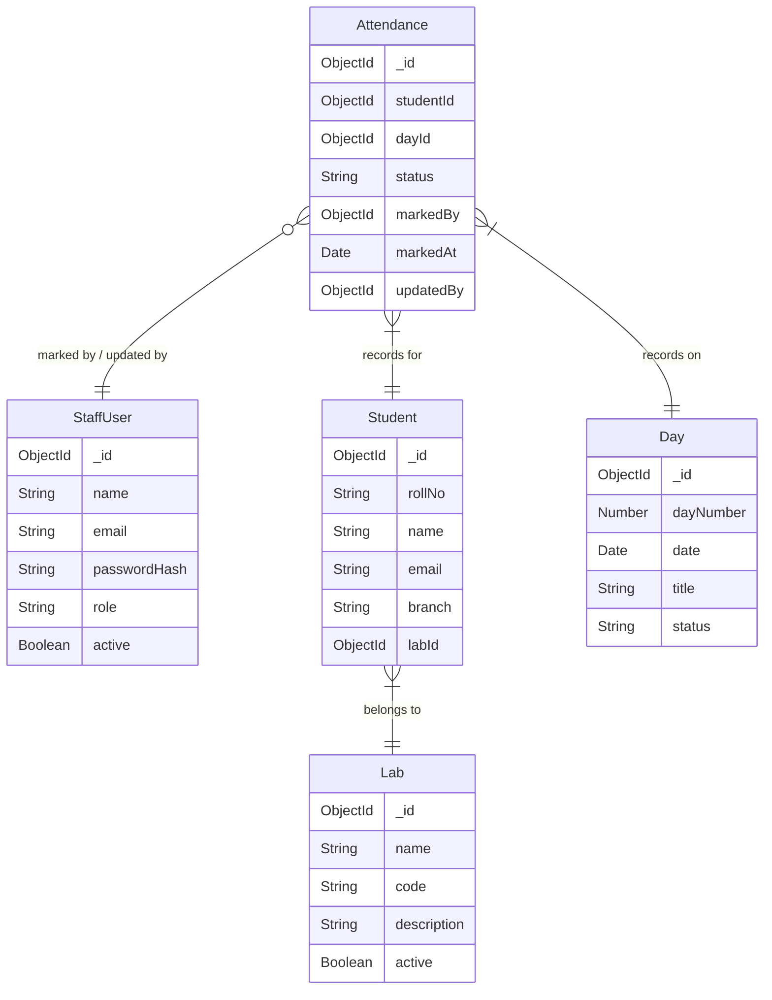

# Database Schema Map

## Entity Relationship Overview

## Models Scaffolded
| Model | File | Fields | References | Status Enum |
|-------|------|--------|------------|-------------|
| StaffUser | src/models/StaffUser.ts | name, email, passwordHash, role, active | — | SUPER_ADMIN, COORDINATOR |
| Student | src/models/Student.ts | rollNo, name, email, branch, labId | Lab (labId) | — |
| Lab | src/models/Lab.ts | name, code, description, active | — | — |
| Day | src/models/Day.ts | dayNumber, date, title, status | — | UPCOMING, ACTIVE, COMPLETED |
| Attendance | src/models/Attendance.ts | studentId, dayId, status, markedBy, markedAt, updatedBy | Student (studentId), Day (dayId), StaffUser (markedBy, updatedBy) | PRESENT, ABSENT |

## Cascade Rules
- Deleting a Student → cascade delete their Attendance records
- Deleting a Lab → cascade delete Students in that Lab (or prevent deletion)
- Deleting a Day → cascade delete Attendance for that Day
